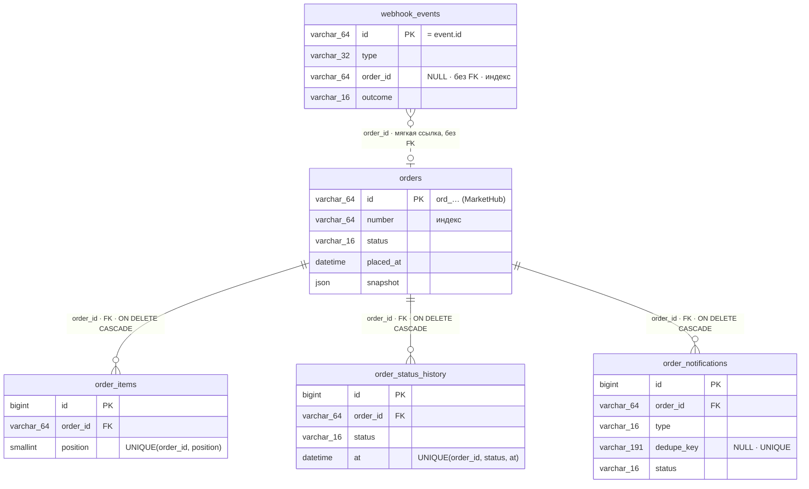

# Архитектура: модель данных

> Дата актуализации: 2026-10-27. Черновик этапа 1 («БД и генерация данных»):
> ERD и справочник доменных таблиц по §6.3 ТЗ. Поток обработки события
> (вебхук → БД → outbox → очередь → Mailpit, §7), структура кода и таблица
> допустимости писем добавляются на этапе 2+ (задачи T-009+); до этого
> документ отражает только состояние схемы БД.

## Содержание

- [Общие правила схемы](#общие-правила-схемы)
- [ERD доменных таблиц](#erd-доменных-таблиц)
- [Справочник таблиц](#справочник-таблиц)
- [Связи и правила удаления](#связи-и-правила-удаления)
- [Инфраструктурные таблицы](#инфраструктурные-таблицы)
- [Воспроизводимость и проверки](#воспроизводимость-и-проверки)

## Общие правила схемы

- Кодировка `utf8mb4`; суммы — только `DECIMAL(12,2)`, плавающих типов в
  схеме нет (проверяется тестом `DomainSchemaTest`);
- Все доменные даты — `DATETIME` (точность 0), хранение в UTC; системные
  метки Eloquent (`created_at`/`updated_at`) — только там, где они указаны
  в §6.3: `orders`, `order_notifications`;
- Перечисления — PHP backed enums (`App\Enums\*`, задача T-004), в колонках
  `VARCHAR(16)`;
- `subtotal` не хранится: вычисляется при выводе как
  `price × quantity` через `Brick\Math\BigDecimal` (§6.3).

## ERD доменных таблиц

На диаграмме — только идентификаторы, ссылки и ключевые поля; полные
составы колонок — в [справочнике](#справочник-таблиц).

## Справочник таблиц

### `orders` — заказы MarketHub

Ключ — идентификатор заказа MarketHub (не автоинкремент:
`$incrementing = false`, `$keyType = 'string'`).

| Колонка | Тип | NULL | Ключи / индексы |
|---|---|---|---|
| `id` | `VARCHAR(64)` | нет | **PK** (`ord_…`) |
| `number` | `VARCHAR(64)` | нет | индекс |
| `status` | `VARCHAR(16)` | нет | индекс `(status, placed_at)` |
| `currency` | `CHAR(3)` | нет | |
| `customer_email` | `VARCHAR(255)` | нет | как пришло в снимке |
| `customer_email_normalized` | `VARCHAR(255)` | нет | индекс `(customer_email_normalized, placed_at)` |
| `customer_name` | `VARCHAR(255)` | нет | |
| `customer_phone` | `VARCHAR(64)` | да | |
| `delivery_price` | `DECIMAL(12,2)` | нет | |
| `discount` | `DECIMAL(12,2)` | нет | |
| `total` | `DECIMAL(12,2)` | нет | |
| `shipment_carrier` | `VARCHAR(64)` | да | все три `NULL` ⇔ `shipment = null` |
| `shipment_tracking_number` | `VARCHAR(64)` | да | |
| `shipment_tracking_url` | `VARCHAR(512)` | да | |
| `placed_at` | `DATETIME` | нет | индекс `(placed_at, id)` — сортировка списка |
| `source_updated_at` | `DATETIME` | нет | |
| `paid_at` | `DATETIME` | да | |
| `cancelled_at` | `DATETIME` | да | |
| `cancel_reason` | `TEXT` | да | |
| `version_event_created_at` | `DATETIME` | нет | компонент версии снимка (FR-ORD-02) |
| `version_event_id` | `VARCHAR(64)` | нет | компонент версии снимка |
| `snapshot` | `JSON` | нет | последний применённый снимок |
| `created_at`, `updated_at` | `TIMESTAMP` | да* | системные метки записи, в API не выходят |

\* В DDL nullable (`$table->timestamps()`); значения всегда заполняет
Eloquent, `NULL` в данных не возникает.

### `order_items` — позиции заказов

| Колонка | Тип | NULL | Ключи / индексы |
|---|---|---|---|
| `id` | `BIGINT UNSIGNED` | нет | **PK**, автоинкремент |
| `order_id` | `VARCHAR(64)` | нет | **FK → `orders.id`, CASCADE** |
| `position` | `SMALLINT` | нет | **UNIQUE `(order_id, position)`** |
| `sku` | `VARCHAR(64)` | нет | |
| `name` | `VARCHAR(255)` | нет | |
| `quantity` | `INT UNSIGNED` | нет | |
| `price` | `DECIMAL(12,2)` | нет | |

### `order_status_history` — история статусов

| Колонка | Тип | NULL | Ключи / индексы |
|---|---|---|---|
| `id` | `BIGINT UNSIGNED` | нет | **PK**, автоинкремент |
| `order_id` | `VARCHAR(64)` | нет | **FK → `orders.id`, CASCADE** |
| `status` | `VARCHAR(16)` | нет | **UNIQUE `(order_id, status, at)`** (идемпотентность FR-HIS-04) |
| `at` | `DATETIME` | нет | индекс `(order_id, at, id)` — хронология |
| `source_event_id` | `VARCHAR(64)` | да | событие, из которого следует факт |

### `webhook_events` — журнал обработки событий вебхуков

| Колонка | Тип | NULL | Ключи / индексы |
|---|---|---|---|
| `id` | `VARCHAR(64)` | нет | **PK** (= `event.id`) |
| `type` | `VARCHAR(32)` | нет | |
| `order_id` | `VARCHAR(64)` | да | **без FK**, индекс (см. ниже) |
| `signature_timestamp` | `INT` | нет | Unix-время из заголовка |
| `payload` | `MEDIUMTEXT` | нет | сырые байты тела, байт в байт |
| `payload_sha256` | `CHAR(64)` | нет | диагностика повторов с другим телом |
| `outcome` | `VARCHAR(16)` | нет | `applied\|stale\|ignored\|rejected` |
| `reject_reason` | `VARCHAR(32)` | да | |
| `deliveries` | `INT` | нет | `DEFAULT 1` |
| `received_at` | `DATETIME` | нет | |
| `last_received_at` | `DATETIME` | да | повторные доставки |
| `processed_at` | `DATETIME` | да | |

### `order_notifications` — transactional outbox писем

| Колонка | Тип | NULL | Ключи / индексы |
|---|---|---|---|
| `id` | `BIGINT UNSIGNED` | нет | **PK**, автоинкремент |
| `order_id` | `VARCHAR(64)` | нет | **FK → `orders.id`, CASCADE** |
| `type` | `VARCHAR(16)` | нет | `paid\|shipped\|cancelled` |
| `dedupe_key` | `VARCHAR(191)` | да | **UNIQUE** (NULL допустимы многократно) |
| `status` | `VARCHAR(16)` | нет | `pending\|sending\|sent\|skipped\|failed` |
| `skip_reason` | `VARCHAR(32)` | да | |
| `recipient` | `VARCHAR(255)` | да | заполняется при отправке |
| `subject` | `VARCHAR(255)` | да | заполняется при отправке |
| `attempts` | `INT UNSIGNED` | нет | `DEFAULT 0` |
| `source_event_id` | `VARCHAR(64)` | нет | событие-триггер |
| `last_error` | `TEXT` | да | |
| `sent_at` | `DATETIME` | да | |
| `created_at`, `updated_at` | `TIMESTAMP` | да* | системные метки |

\* В DDL nullable (`$table->timestamps()`); значения всегда заполняет
Eloquent, `NULL` в данных не возникает.

## Связи и правила удаления

Eloquent-связи (модель `Order`): `items()`, `history()`, `notifications()` —
`hasMany`; обратные — `order(): BelongsTo`. `WebhookEvent::order()` —
`belongsTo` по мягкой ссылке, может быть `null`.

| Связь | Правило на уровне БД | Обоснование |
|---|---|---|
| `order_items.order_id` → `orders.id` | FK, `ON DELETE CASCADE` | задано §6.3 |
| `order_status_history.order_id` → `orders.id` | FK, `ON DELETE CASCADE` | история — производные данные заказа |
| `order_notifications.order_id` → `orders.id` | FK, `ON DELETE CASCADE` | outbox-запись создаётся в одной транзакции с заказом (FR-MAIL-01); приложение заказы не удаляет |
| `webhook_events.order_id` → `orders.id` | **без FK** (индекс) | событие вставляется в журнал **до** создания заказа (§7, шаг 13a); для событий неизвестных типов `order_id = NULL`; журнал — независимый аудит, при удалении заказа строки сохраняются с исходной ссылкой |

Полная таблица решений по FK и типам — [`DECISIONS.md`](../DECISIONS.md),
разделы «Задача 003» и «Задача 008».

## Инфраструктурные таблицы

Стандартные миграции Laravel, доменными не являются: `users`,
`cache`/`cache_locks`, `jobs`/`job_batches`/`failed_jobs` (последние —
очередь Redis/Horizon). Очередные таблицы не дублируются собственными
миграциями (проверяется тестом `DomainSchemaTest`).

## Воспроизводимость и проверки

Схема воспроизводима на чистой MySQL 8.4: `migrate:fresh` → фабричная
генерация (`database/factories/*`) → `db:seed` (`DemoOrdersSeeder`) →
`migrate:rollback` → повторный `migrate` с сидером. Полный цикл зафиксирован
тестом `DatabaseReproducibilityTest` (поглотил rollback-сценарий T-003);
составные части — `DomainSchemaTest` (схема/ограничения/FK),
`DomainModelsTest` (модели/связи/касты, включая висячую мягкую ссылку),
`DomainFactoriesTest` (фабрики), `DemoOrdersSeederTest` (демо-набор).
Источник требований к схеме — §6.3 ТЗ (`plan/TZ-markethub-orders-service-v1.5.md`).
