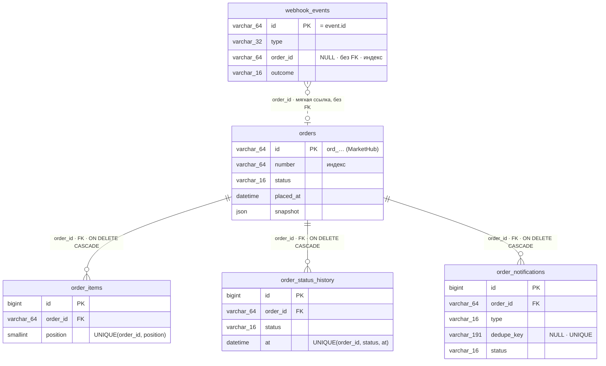

# Архитектура: модель данных и доменный слой

> Дата актуализации: 2026-10-28. Этап 1 — ERD и справочник доменных таблиц
> по §6.3 ТЗ; этап 2 (T-009) — скелет доменного слоя: конфигурация
> маркетплейса, DTO, классы доменных правил и исключения вебхука;
> этап 2 (T-010) — скелет обработки вебхука: маршрут, middleware
> подписи, Action и HTTP-маппинг результатов; этап 2 (T-011) — скелет
> API заказов: маршруты, FormRequest, query-класс и Resources;
> этап 2 (T-012) — скелет уведомлений и очереди: Job отправки,
> Mailable'ы, dedupe-ключ, переходы статусов уведомления, sweeper
> и очистка событий в планировщике; этап 2 (T-013) — скелет
> Inertia-админки (гибрид Q3): страницы-оболочки со вспомогательными
> props, клиентский слой запросов к `/api/orders`, layout и базовые
> компоненты; этап 2 (T-014) — инфраструктура качества (`composer
> check`) и каркас документации (`docs/webhooks.md`,
> `docs/testing.md`, `docs/operations.md`); этап 4 (T-034) — механика
> отправки уведомлений: шаги 2–5 задания `SendOrderNotification`.

## Содержание

- [Общие правила схемы](#общие-правила-схемы)
- [ERD доменных таблиц](#erd-доменных-таблиц)
- [Справочник таблиц](#справочник-таблиц)
- [Связи и правила удаления](#связи-и-правила-удаления)
- [Инфраструктурные таблицы](#инфраструктурные-таблицы)
- [Доменный слой: конфигурация, DTO, правила](#доменный-слой-конфигурация-dto-правила)
- [Скелет обработки вебхука (T-010)](#скелет-обработки-вебхука-t-010)
- [Скелет API заказов (T-011)](#скелет-api-заказов-t-011)
- [Скелет уведомлений и очереди (T-012)](#скелет-уведомлений-и-очереди-t-012)
- [Скелет Inertia-админки (T-013)](#скелет-inertia-админки-t-013)
- [Слой данных списка (T-039)](#слой-данных-списка-t-039)
- [Страница списка (T-040)](#страница-списка-t-040)
- [Воспроизводимость и проверки](#воспроизводимость-и-проверки)

## Общие правила схемы

- Кодировка `utf8mb4`; суммы — только `DECIMAL(12,2)`, плавающих типов в
  схеме нет (проверяется тестом `DomainSchemaTest`);
- Все доменные даты — `DATETIME` (точность 0), хранение в UTC; системные
  метки Eloquent (`created_at`/`updated_at`) — только там, где они указаны
  в §6.3: `orders`, `order_notifications`;
- Перечисления — PHP backed enums (`App\Enums\*`, задача T-004), в колонках
  `VARCHAR(16)`;
- `subtotal` не хранится: вычисляется при выводе как
  `price × quantity` через `Money::subtotal` (BigDecimal, §6.3; T-022).

## ERD доменных таблиц

На диаграмме — только идентификаторы, ссылки и ключевые поля; полные
составы колонок — в [справочнике](#справочник-таблиц).



## Справочник таблиц

### `orders` — заказы MarketHub

Ключ — идентификатор заказа MarketHub (не автоинкремент:
`$incrementing = false`, `$keyType = 'string'`).

| Колонка | Тип | NULL | Ключи / индексы |
|---|---|---|---|
| `id` | `VARCHAR(64)` | нет | **PK** (`ord_…`) |
| `number` | `VARCHAR(64)` | нет | индекс |
| `status` | `VARCHAR(16)` | нет | индекс `(status, placed_at)` |
| `currency` | `CHAR(3)` | нет | |
| `customer_email` | `VARCHAR(255)` | нет | как пришло в снимке |
| `customer_email_normalized` | `VARCHAR(255)` | нет | индекс `(customer_email_normalized, placed_at)` |
| `customer_name` | `VARCHAR(255)` | нет | |
| `customer_phone` | `VARCHAR(64)` | да | |
| `delivery_price` | `DECIMAL(12,2)` | нет | |
| `discount` | `DECIMAL(12,2)` | нет | |
| `total` | `DECIMAL(12,2)` | нет | |
| `shipment_carrier` | `VARCHAR(64)` | да | все три `NULL` ⇔ `shipment = null` |
| `shipment_tracking_number` | `VARCHAR(64)` | да | |
| `shipment_tracking_url` | `VARCHAR(512)` | да | |
| `placed_at` | `DATETIME` | нет | индекс `(placed_at, id)` — сортировка списка |
| `source_updated_at` | `DATETIME` | нет | |
| `paid_at` | `DATETIME` | да | |
| `cancelled_at` | `DATETIME` | да | |
| `cancel_reason` | `TEXT` | да | |
| `version_event_created_at` | `DATETIME` | нет | компонент версии снимка (FR-ORD-02) |
| `version_event_id` | `VARCHAR(64)` | нет | компонент версии снимка |
| `snapshot` | `JSON` | нет | последний применённый снимок |
| `created_at`, `updated_at` | `TIMESTAMP` | да* | системные метки записи, в API не выходят |

\* В DDL nullable (`$table->timestamps()`); значения всегда заполняет
Eloquent, `NULL` в данных не возникает.

### `order_items` — позиции заказов

| Колонка | Тип | NULL | Ключи / индексы |
|---|---|---|---|
| `id` | `BIGINT UNSIGNED` | нет | **PK**, автоинкремент |
| `order_id` | `VARCHAR(64)` | нет | **FK → `orders.id`, CASCADE** |
| `position` | `SMALLINT` | нет | **UNIQUE `(order_id, position)`** |
| `sku` | `VARCHAR(64)` | нет | |
| `name` | `VARCHAR(255)` | нет | |
| `quantity` | `INT UNSIGNED` | нет | |
| `price` | `DECIMAL(12,2)` | нет | |

### `order_status_history` — история статусов

| Колонка | Тип | NULL | Ключи / индексы |
|---|---|---|---|
| `id` | `BIGINT UNSIGNED` | нет | **PK**, автоинкремент |
| `order_id` | `VARCHAR(64)` | нет | **FK → `orders.id`, CASCADE** |
| `status` | `VARCHAR(16)` | нет | **UNIQUE `(order_id, status, at)`** (идемпотентность FR-HIS-04) |
| `at` | `DATETIME` | нет | индекс `(order_id, at, id)` — хронология |
| `source_event_id` | `VARCHAR(64)` | да | событие, из которого следует факт |

### `webhook_events` — журнал обработки событий вебхуков

| Колонка | Тип | NULL | Ключи / индексы |
|---|---|---|---|
| `id` | `VARCHAR(64)` | нет | **PK** (= `event.id`) |
| `type` | `VARCHAR(32)` | нет | |
| `order_id` | `VARCHAR(64)` | да | **без FK**, индекс (см. ниже) |
| `signature_timestamp` | `INT` | нет | Unix-время из заголовка |
| `payload` | `MEDIUMTEXT` | нет | сырые байты тела, байт в байт |
| `payload_sha256` | `CHAR(64)` | нет | диагностика повторов с другим телом |
| `outcome` | `VARCHAR(16)` | нет | `applied\|stale\|ignored\|rejected` |
| `reject_reason` | `VARCHAR(32)` | да | |
| `deliveries` | `INT` | нет | `DEFAULT 1` |
| `received_at` | `DATETIME` | нет | |
| `last_received_at` | `DATETIME` | да | повторные доставки |
| `processed_at` | `DATETIME` | да | |

### `order_notifications` — transactional outbox писем

| Колонка | Тип | NULL | Ключи / индексы |
|---|---|---|---|
| `id` | `BIGINT UNSIGNED` | нет | **PK**, автоинкремент |
| `order_id` | `VARCHAR(64)` | нет | **FK → `orders.id`, CASCADE** |
| `type` | `VARCHAR(16)` | нет | `paid\|shipped\|cancelled` |
| `dedupe_key` | `VARCHAR(191)` | да | **UNIQUE** (NULL допустимы многократно) |
| `status` | `VARCHAR(16)` | нет | `pending\|sending\|sent\|skipped\|failed` |
| `skip_reason` | `VARCHAR(32)` | да | |
| `recipient` | `VARCHAR(255)` | да | заполняется при отправке |
| `subject` | `VARCHAR(255)` | да | заполняется при отправке |
| `attempts` | `INT UNSIGNED` | нет | `DEFAULT 0` |
| `source_event_id` | `VARCHAR(64)` | нет | событие-триггер |
| `last_error` | `TEXT` | да | |
| `sent_at` | `DATETIME` | да | |
| `created_at`, `updated_at` | `TIMESTAMP` | да* | системные метки |

\* В DDL nullable (`$table->timestamps()`); значения всегда заполняет
Eloquent, `NULL` в данных не возникает.

## Связи и правила удаления

Eloquent-связи (модель `Order`): `items()`, `history()`, `notifications()` —
`hasMany`; обратные — `order(): BelongsTo`. `WebhookEvent::order()` —
`belongsTo` по мягкой ссылке, может быть `null`.

| Связь | Правило на уровне БД | Обоснование |
|---|---|---|
| `order_items.order_id` → `orders.id` | FK, `ON DELETE CASCADE` | задано §6.3 |
| `order_status_history.order_id` → `orders.id` | FK, `ON DELETE CASCADE` | история — производные данные заказа |
| `order_notifications.order_id` → `orders.id` | FK, `ON DELETE CASCADE` | outbox-запись создаётся в одной транзакции с заказом (FR-MAIL-01); приложение заказы не удаляет |
| `webhook_events.order_id` → `orders.id` | **без FK** (индекс) | событие вставляется в журнал **до** создания заказа (§7, шаг 13a); для событий неизвестных типов `order_id = NULL`; журнал — независимый аудит, при удалении заказа строки сохраняются с исходной ссылкой |

Полная таблица решений по FK и типам — [`DECISIONS.md`](../DECISIONS.md),
разделы «Задача 003» и «Задача 008».

## Инфраструктурные таблицы

Стандартные миграции Laravel, доменными не являются: `users`,
`cache`/`cache_locks`, `jobs`/`job_batches`/`failed_jobs` (последние —
очередь Redis/Horizon). Очередные таблицы не дублируются собственными
миграциями (проверяется тестом `DomainSchemaTest`).

## Доменный слой: конфигурация, DTO, правила

Структура — по §10 ТЗ (T-009): DTO в `app/Data/`, доменные правила —
`app/Support/`, исключения вебхука — `app/Exceptions/Webhook/`. Парсинг
сырого JSON в DTO (валидация конверта и снимка) — задача T-021; классов
парсера в T-009 сознательно нет.

### Конфигурация `config/marketplace.php`

| Ключ | Env | Умолчание | Назначение (ТЗ) |
|---|---|---|---|
| `webhook_secret` | `MARKETPLACE_WEBHOOK_SECRET` | `''` | секрет подписи; пустое значение — fail closed (Q11) |
| `webhook_tolerance` | `MARKETPLACE_WEBHOOK_TOLERANCE` | `300` | окно timestamp, с (FR-WH-03) |
| `webhook_max_body_bytes` | — | `1048576` | лимит тела вебхука, байты (FR-WH-12): строго больше — 413; фиксированная константа протокола, env не имеет (T-025) |
| `order_lock_timeout` | `MARKETPLACE_ORDER_LOCK_TIMEOUT` | `3` | ожидание блокировки заказа, с (FR-ORD-07) |
| `order_lock_lease` | `MARKETPLACE_ORDER_LOCK_LEASE` | `15` | срок владения блокировкой, с (> `MAIL_TIMEOUT`) |
| `terminal_statuses` | — | `['delivered','cancelled']` | терминальные статусы Q35/FR-ORD-09; единственное место истины для `OrderStatus::isTerminal()` |
| `events_retention_days` | `MARKETPLACE_EVENTS_RETENTION_DAYS` | `90` | хранение сырых событий, дней (Q20) |
| `notifications.max_attempts` | `NOTIFICATIONS_TRIES` | `5` | попыток отправки письма (FR-MAIL-05) |
| `notifications.backoff` | — | `[10, 60, 300, 900]` | паузы повторов: 10 с / 1 м / 5 м / 15 м |
| `notifications.sweep_after_seconds` | `NOTIFICATIONS_SWEEP_AFTER_SECONDS` | `120` | порог sweeper'а pending-уведомлений (FR-MAIL-06) |
| `notifications.refund_days` | `NOTIFICATIONS_REFUND_DAYS` | `10` | срок возврата в письме об отмене (§6.5) |

SMTP timeout читается отдельно: `config/mail.php` → `MAIL_TIMEOUT`
(5 с, §5.3).

### DTO (`app/Data/`, readonly, без Eloquent)

| Класс | Что представляет |
|---|---|
| `MarketplaceEvent` | конверт события: `id`, `type`, `createdAt` (момент с исходным смещением), `?order` — null для событий без валидного снимка (неизвестный тип/статус) |
| `OrderSnapshot` | полный снимок `data.order` после валидации известного статуса; `status` — enum; суммы — строки с двумя знаками; nullable-поля — explicit null |
| `OrderCustomer` / `OrderItemSnapshot` / `OrderShipment` | вложенные значения снимка (`phone` nullable; `shipment` — объект или null) |
| `Version` | кортеж сравнимости `(order.updated_at, event.created_at, event.id)` (FR-ORD-02) |
| `HistoryFact` | «статус @ момент» из снимка (FR-HIS-02); `source_event_id` проставляет запись в БД |

### Доменные правила (`app/Support/`) и статус реализации

| Класс | Сигнатура | Реализация |
|---|---|---|
| `SnapshotVersionComparator` | `isNewer(Version $incoming, Version $stored): bool` | готов (T-023): покомпонентное сравнение кортежа с ранним выходом — моменты UTC (`->utc()`), финальный tie-break `event.id` строкой (ULID не декодируется); строгое `>` — равные и старые версии не новее; подключён в шаг 13c §7 обработчиком (T-028) |
| `Money` | `subtotal(string $price, int $quantity): string` | готова (T-022): BigDecimal `price × quantity` без float, строка с двумя знаками; единая точка денежной арифметики для API, warning-проверки total и состава писем (подключена в T-033) |
| `HistoryBuilder` | `factsFromSnapshot(OrderSnapshot): list<HistoryFact>`; `rollbackFact(OrderStatus, OrderSnapshot): ?HistoryFact` | готов (T-030): факты FR-HIS-01/02 (`created@created_at` всегда, `paid`/`cancelled` по родным полям, текущий статус со fallback на `updated_at`) и факт коррекции FR-HIS-03 (строгое убывание ранга); запись в БД идемпотентная (insertOrIgnore) — потребитель `ProcessMarketplaceEvent` в ветках 13c/13e |
| `NotificationPolicy` | `allows(NotificationType $type, OrderStatus $currentStatus): bool` | готова (T-031): явная таблица match по §6.5 — `paid` → paid/shipped/delivered, `shipped` → shipped/delivered, `cancelled` → только cancelled, при `created` — никаких; Q28 (нет письма-исправления) — правило триггера T-032, не матрицы; потребитель — FR-MAIL-03 (шаг 3 job, T-034) |

До реализации методы бросают `LogicException` с номером задачи-владельца
(заглушка не изображает успешный результат — правило этапа 2).

### Исключения вебхука (`app/Exceptions/Webhook/`)

| Исключение | HTTP | Когда |
|---|---|---|
| `InvalidSignature` | 401 | формат/наличие заголовков, HMAC не совпал (FR-WH-02/04) |
| `StaleTimestamp` | 401 | timestamp вне окна (FR-WH-03) |
| `MalformedPayload` | 400 / 422 | тело не по протоколу; причина — enum `App\Enums\PayloadIssue`: `invalid_json`/`event_id_mismatch` → 400 (FR-WH-05), `invalid_envelope`/`invalid_snapshot` → 422 (FR-WH-06/08) |
| `PayloadTooLarge` | 413 | тело больше 1 MiB (FR-WH-12; бросает `LimitMarketplaceWebhookBody`, T-025) |
| `WebhookUnavailable` | 503 | блокировка заказа не получена за `order_lock_timeout` либо исчерпаны попытки транзакции при deadlock — повторяемый отказ (FR-WH-10/FR-ORD-07); контракт закреплён T-025, бросает `ProcessMarketplaceEvent` (T-027) |

HTTP-маппинг — `WebhookResponseMapper` (T-010/T-025). NFR-04: сообщения
не содержат секрет, подпись и тело запроса; 401 одинаков для всех причин
отказа аутентификации. Вся иерархия исключена из репортинга
(`ShouldntReport`, T-025): ожидаемые клиентские 401/400/422/413
и повторяемый 503 не пишут стектрейсы в логи (наблюдаемость — warning
NFR-06, задачи T-026/T-027).

## Скелет обработки вебхука (T-010)

Поток входящего вебхука по §7/§10 ТЗ — HTTP-слой отделён от
транзакционной логики:

```text
POST /api/webhooks/marketplace                    routes/api.php (api-группа: без CSRF/throttle, FR-WH-11)
  → LimitMarketplaceWebhookBody                   §7 шаг 1: лимит 1 MiB по Content-Length и фактическим байтам → 413 (T-025)
  → VerifyMarketplaceSignature                    §7 шаги 2–4: заголовки, окно, HMAC
  → MarketplaceWebhookController                  тонкий HTTP-слой: Request → IncomingWebhook
  → ProcessMarketplaceEvent::handle()             §7 шаги 5–14, один Action (разбор T-021, журнал/идемпотентность T-026,
                                                   блокировки order:{id} + FOR UPDATE T-027, применение снимка T-028;
                                                   терминальные статусы T-029, история статусов T-030; outbox — T-032)
      → WebhookProcessingResult                   processed|duplicate|stale|ignored|rejected
  → WebhookResponseMapper::fromResult()           200 {"status": …}

WebhookException (middleware или Action) → $exceptions->render() в bootstrap/app.php
  → WebhookResponseMapper::fromException()        401 едино / 400/422 по PayloadIssue / 413 лимит / 503 недоступность
```

| Компонент | Файл | Статус |
|---|---|---|
| Маршрут | `routes/api.php` | готов (api-маршрутизация включена в `bootstrap/app.php` вручную, FR-WH-01); порядок middleware — лимит тела, затем подпись (§7 шаги 1→4) |
| Лимит тела | `app/Http/Middleware/LimitMarketplaceWebhookBody.php` | готов (T-025): Content-Length + фактический размер, ровно 1 MiB допустимо |
| Проверка подписи | `app/Http/Middleware/VerifyMarketplaceSignature.php` | готова (T-010/T-024): заголовки, окно, сверка HMAC `hash_equals`, fail closed |
| Контроллер | `app/Http/Controllers/Api/MarketplaceWebhookController.php` | готов (без бизнес-логики) |
| Контекст доставки | `app/Data/IncomingWebhook.php` | готов (DTO: X-Webhook-Id, timestamp, сырое тело) |
| Оркестрация | `app/Actions/Webhooks/ProcessMarketplaceEvent.php` | разбор тела (T-021), журнал/идемпотентность `event.id` (T-026: идемпотентная вставка `webhook_events`, duplicate-ветка), контур конкурентности (T-027: Redis-lock `order:{id}` вокруг транзакции, `lockForUpdate` строки заказа 13b, deadlock-ретраи `attempts: 3`, освобождение в finally), применение снимка (T-028: версия/stale 13c, полная перезапись заказа и позиций 13e, финализация исхода журнала 13g), терминальные статусы 13d (T-029), факты истории 13c/13e (T-030: insertOrIgnore в `order_status_history`, `HistoryBuilder`) и outbox 13f/14 (T-032: триггер смены статуса `NotificationTrigger`, запись `order_notifications` с дедупом `UNIQUE(dedupe_key)`, dispatch после commit) готовы |
| Результаты | `app/Enums/WebhookProcessingResult.php` | готов; `fromOutcome(EventOutcome)`: `applied` → `processed`, `duplicate` только в HTTP |
| Ответы | `app/Http/Responses/WebhookResponseMapper.php` | готов (T-010/T-025): 200/401/400/422/413; ветка 503 `temporarily_unavailable` — с T-027 её бросает Action (занятый lock, исчерпание deadlock-ретраев) |

Тела ошибок — `{"error":{"code": …, "message": …}}` со статичными
текстами; 401 един для InvalidSignature и StaleTimestamp (`unauthorized`,
NFR-04), коды 400/422 — по `PayloadIssue`, 413 — `payload_too_large`,
503 — `temporarily_unavailable`. С T-026 журналируются исходы
`ignored`/`duplicate`; с T-027 событие известного типа обрабатывается
под блокировкой заказа (контур — ниже); с T-028 снимок применяется
(200 `processed`/`stale`) — подробности в `DECISIONS.md`, разделы
«Задача 010»/«Задача 026»/«Задача 027»/«Задача 028».

### Контур конкурентности обработки (T-027, FR-ORD-07)

```text
известный тип со снимком (шаги 12–13 §7)
  Cache::lock("order:{id}", lease=order_lock_lease)          Redis-драйвер кэша в бою; lease 15 c > SMTP timeout
    -> block(order_lock_timeout)                              не взят за 3 с → warning order_lock_timeout → 503
  DB::transaction(attempts: 3)                                конкурентная ошибка (1213/1205) → повтор целиком;
                                                               исчерпаны → warning transaction_retry_exhausted → 503
    13a INSERT webhook_events (PK = event.id)                 дубль → duplicate-ветка (deliveries++, 200 duplicate)
    13b Order::lockForUpdate()->find(id)                      SELECT … FOR UPDATE; нет строки (первый снимок) → null
    13c версия не новее → outcome=stale + processed_at        200 stale, заказ не меняется (FR-ORD-02); факты истории
                                                                из stale-снимка принимаются (FR-HIS-02, T-030)
    13d терминальный статус → rejected                        T-029: delivered/cancelled закрыты для переходов (Q35)
    13e полная перезапись заказа + позиций, версия, snapshot  FR-ORD-04/06; placed_at = created_at MarketHub, даты в UTC;
                                                               позиции delete+insert, position 1..N; факты истории
                                                               и отката (FR-HIS-02/03, T-030) — insertOrIgnore
    13f outbox-уведомление при допустимой смене статуса      T-032: триггер NotificationTrigger (тип из нового статуса,
                                                               без фильтра event.type; откат Q28 и «тот же статус» — без
                                                               письма); запись pending в этой же транзакции; дубль
                                                               UNIQUE(dedupe_key) — молчаливый пропуск (FR-MAIL-02)
    13g outcome=applied + processed_at                        финализация журнала, commit → 200 processed
  afterCommit: SendOrderNotification::dispatch(id)            шаг 14 §7: постановка после commit транзакции; неудача —
                                                               warning dispatch_failed + 200 processed, pending подберёт
                                                               sweeper (FR-MAIL-06, T-035)
  finally: lock->release()                                    на все исходы, включая исключения
```

Сетевые вызовы (SMTP/HTTP) внутри контура запрещены (NFR-01): письмо
идёт через outbox и очередь (запись — T-032, отправка — T-034), воркер
берёт тот же `Cache::lock("order:{id}")` (FR-MAIL-03) — вебхук
и отправка письма не меняют состояние заказа одновременно.

## API заказов (T-011, query-выборка завершена в T-036)

Чтение заказов для админки по контракту `task/openapi.yaml` (§6.6 ТЗ) —
слои как у вебхука: HTTP → выборка → сериализация:

```text
GET /api/orders                                    routes/api.php (orders.index)
  → ListOrdersRequest                              FR-API-02/03/08: фильтры+пагинация → 422 стандартного формата;
                                                   email: формат адреса + max:255, нормализация trim+lower (A-30, T-036)
  → OrderListParameters (DTO)                      валидированные параметры (email уже нормализован), дефолты page=1/per_page=20
  → OrderListQuery::paginate()                     FR-API-01..03: сортировка, status- и email-фильтры, пагинация + withQueryString
  → OrderListItemResource::collection()            FR-API-04: стандартная обёртка data/links/meta

GET /api/orders/{id}                               routes/api.php (orders.show)
  → Api\Orders\ShowController::__invoke            implicit binding по строковому ключу + eager loading items(position)/history, 404 → JSON
  → OrderResource                                  FR-API-05/06/07: все поля контракта, subtotal, даты UTC +00:00;
                                                  история по FR-HIS-04: at, ранг статуса, id
```

| Компонент | Файл | Статус |
|---|---|---|
| Маршруты | `routes/api.php` | готовы; состав api-маршрутов = контракт + вебхук, зафиксирован тестом (FR-API-11); `GET /up` — опция `health` в `bootstrap/app.php` |
| Валидация | `app/Http/Requests/Api/ListOrdersRequest.php` | готова (422 стандартного Laravel, пустые фильтры игнорируются; email — формат + max:255 и нормализация trim+lower до DTO, T-036) |
| Параметры | `app/Data/OrderListParameters.php` | готов (readonly DTO; email приходит нормализованным) |
| Выборка | `app/Http/Queries/OrderListQuery.php` | готова (T-036): сортировка/status/пагинация + email — точное совпадение по `customer_email_normalized` (покрывает индекс `(customer_email_normalized, placed_at)`) |
| Контроллеры | `app/Http/Controllers/Api/Orders/IndexController.php`, `ShowController.php` | готовые invokable (тонкие, по одной операции; карточка: eager loading items по position, history — порядок задаёт Resource) |
| Список | `app/Http/Resources/OrderListItemResource.php` | поля контракта, даты MarketHub (FR-API-07) |
| Карточка | `app/Http/Resources/OrderResource.php` | поля контракта + subtotal (`Money::subtotal`, T-022) + история по FR-HIS-04 (at, ранг, id — сортировка коллекцией); контрактная проверка — T-037/T-038 |

Ответы api/* — всегда JSON независимо от Accept (`shouldRenderJsonWhen`
из T-010, FR-API-09). Фильтр email реализован в T-036; подробности
и решения — в `DECISIONS.md`, раздел «Задача 036».

## Скелет уведомлений и очереди (T-012)

Исходящие письма покупателю — transactional outbox (§6.5 ТЗ):

```text
применение снимка (T-028, транзакция)
  → 13f: NotificationTrigger::typeFor(prev, new)        T-032: смена статуса на paid/shipped/cancelled,
                                                          не откат (Q28), не «тот же статус»; тип — из нового
                                                          статуса, без фильтра event.type
  → order_notifications (pending, attempts=0,            outbox-запись в той же транзакции (T-032);
    dedupe_key, source_event_id)                          дубль UNIQUE(dedupe_key) — молчаливый пропуск
                                                          (FR-MAIL-02); ключ shipped — трек события-триггера
  → 14: после commit SendOrderNotification::dispatch(id)  DB::afterCommit, изолировано от ответа: неудача —
                                                          warning dispatch_failed + 200 processed, pending
                                                          подберёт sweeper (FR-MAIL-06, T-035)
        1. загрузка; status ≠ pending → выход           идемпотентность повторной постановки (T-012)
        2. Cache::lock("order:{id}")->block(timeout)    реализовано (T-034, FR-MAIL-03): тот же ключ, что
                                                           у вебхука; не взят → warning + release по backoff
                                                           («повторить по политике очереди», запись не
                                                           меняется); release в finally, отказ освобождения
                                                           гасится с warning — lease истечёт сам (решение
                                                           заметки ревью T-027 P3-4)
        3. транзакция: FOR UPDATE + политика/email/      реализовано (T-034): проверки по ТЕКУЩЕМУ состоянию;
           shipment; при запрете — skipped               матрица §6.5 → skipped(superseded), невалидный email
                                                           → skipped(invalid_recipient), shipped без shipment
                                                           → skipped(no_shipment), всё с dedupe_key=NULL;
                                                           сверка ключа с текущим треком (S-38): атомарный
                                                           update ключа либо skipped(duplicate_tracking)
        4. атомарный захват pending → sending            реализовано (T-034, FR-MAIL-04): условный UPDATE по
                                                           status=pending; 0 строк — тихий выход (второй
                                                           воркер не отправит параллельно)
        5. отправка текста и фиксация sent/retry/failed  реализовано (T-034): Mail::to(текущий email)->send()
                                                           синхронно (мейблы без ShouldQueue — заданию нужен
                                                           результат); sent/sent_at/recipient/subject либо
                                                           pending+attempts++ и release(backoff), после
                                                           NOTIFICATIONS_TRIES — failed+last_error;
                                                           терминальная ветвь failed() перезагружает запись
                                                           по notificationId (переход sending → failed)

планировщик (routes/console.php, Schedule::command)
  → notifications:sweep  каждую минуту, withoutOverlapping   FR-MAIL-06: pending старше
    sweep_after секунд → re-dispatch job (шаг 1 делает это безопасным)
  → webhooks:prune       раз в сутки, withoutOverlapping      Q20: received_at старше
    retention дней → удаление батчами chunkById(1000)
```

| Компонент | Файл | Статус |
|---|---|---|
| Триггер outbox | `app/Support/NotificationTrigger.php` | готов (T-032): чистая функция `typeFor(prev, new)` — тип из нового статуса, без смены/при откате (Q28) — null; первый снимок триггер проходит; полная матрица 6×5 — `NotificationTriggerTest` |
| Задание отправки | `app/Jobs/SendOrderNotification.php` | готов (T-034): шаги 2–5 §7 — блокировка заказа, предотправочные проверки по текущему состоянию, атомарный захват, синхронная отправка с retry/backoff и `failed()`-ветвью; `$tries`/`backoff()` из config, `afterCommit` (T-012) |
| Письма | `app/Mail/{OrderPaidMail,OrderShippedMail,OrderCancelledMail}.php` | тексты готовы (T-033): темы и тела дословно §6.5 («№» U+2116; суммы — как в снимке + валюта A-26, стоимость позиции через `Money::subtotal`), plain text UTF-8; тела — `resources/views/mail/order-*.blade.php` |
| Dedupe-ключ | `app/Support/NotificationDedupeKey.php` | готов: `{order_id}:{type}` / `{order_id}:shipped:{tracking}` (FR-MAIL-02); фабрика уведомлений переведена на него |
| Переходы статусов | `App\Enums\NotificationStatus::canTransitionTo()` | готов: карта-данные (pending→sending/skipped; sending→sent/skipped/failed/pending; sent/skipped/failed терминальные) |
| Политика допустимости | `app/Support/NotificationPolicy.php` | готова (T-031): матрица §6.5 (paid → paid/shipped/delivered; shipped → shipped/delivered; cancelled → только cancelled); сигнатура T-009 сохранена, чистая функция без контейнера |
| Sweeper | `app/Console/Commands/SweepPendingNotificationsCommand.php` | готов: порог по `updated_at` из config, re-dispatch job |
| Очистка событий | `app/Console/Commands/PruneWebhookEventsCommand.php` | готов: удаление по `received_at` старше retention, батчами |

Полный конвейер писем реализован: outbox-запись (T-032) → задание
отправки (T-034) → синхронный Mailable (T-033). Повторная постановка
(sweeper, повторная доставка вебхука) безопасна — шаг 1 и атомарный
захват FR-MAIL-04; зависший `sending` не переотправляется
(Q25/NFR-05) — ручная процедура в [`operations.md`](operations.md).
Решения и обоснования — в `DECISIONS.md`, разделы «Задача 012»/
«Задача 034».

## Скелет Inertia-админки (T-013)

Админка — гибрид (FR-ADM-05, §16.2 ТЗ): Inertia отвечает за маршруты,
layout и навигацию, данные заказов браузер запрашивает напрямую
у методов контракта `task/openapi.yaml`:

```text
GET /                       → 302 /admin/orders                    FR-ADM-01
GET /admin/orders           → Inertia admin/orders/Index           props: statusOptions, defaultPerPage
        браузер → GET /api/orders?status=&email=&page=&per_page=  клиентский слой, Q3-гибрид
GET /admin/orders/{id}      → Inertia admin/orders/Show            props: только id
        браузер → GET /api/orders/{id}                             404 = клиентское «не найден»
```

| Слой | Файлы | Назначение |
|---|---|---|
| Контроллеры-оболочки | `app/Http/Controllers/Admin/Orders/IndexController.php`, `ShowController.php` | только вспомогательные props (FR-ADM-05); заказы через props не передаются (пиннится тестами) |
| Дефолты пагинации | `App\Http\Requests\Api\ListOrdersRequest::DEFAULT_*` | единый источник 1/20 для API и props админки |
| TS-типы контракта | `resources/js/types/api.ts` | `OrderStatus` (+guard), `OrderListItem`, `Order` (customer/items/shipment/history), `PaginationLinks/Meta`, `PaginatedOrders` — по схемам openapi, включая nullable |
| Транспорт | `resources/js/lib/api/client.ts` | `requestJson` + `ApiError` (not-found/validation/http/network/parse); 422 — стандартное тело валидации Laravel |
| API заказов | `resources/js/lib/api/orders.ts` | `fetchOrders`/`fetchOrder`, маппинг query-string ↔ параметры API (`status/email/page/per_page`, пропуск пустых, мусор отбрасывается), экранирование id, `adminOrdersUrl` — копируемые адреса `/admin/orders?…` (T-039) |
| Сообщения об ошибках | `resources/js/lib/api/errors.ts` | русские тексты по классам ошибки (Q38); `toApiError` — в `client.ts` |
| Composables | `resources/js/composables/{useOrdersList,useOrder}.ts` | `useOrdersList` — состояние фильтров/страницы, синхронизация с query-string, защита от гонок (T-039); `useOrder` — данные карточки/loading/error |
| Layout и компоненты | `resources/js/layouts/AdminLayout.vue`, `resources/js/components/admin/*` | шапка с навигацией; `StatusBadge` (delivered выделен primary), `EmptyState`, `OrderFilters` (sentinel «Все статусы», «Сбросить»), `OrderPagination` (ссылки `/admin/orders?…&page=N` по `meta` + номера страниц, T-039/T-040) |
| Страницы | `resources/js/pages/admin/orders/{Index,Show}.vue` | список — полный UI (таблица/карточки, T-040); карточка-оболочка — богатая вёрстка T-041 |

Даты отображаются в часовом поясе браузера через
`Intl.DateTimeFormat('ru-RU')` (`resources/js/lib/format.ts`), API
продолжает отдавать UTC. Wayfinder-функции для запросов не
используются: `resources/js/routes` — gitignored-артефакт генерации
vite; пути фиксированы контрактом и ТЗ (обоснование — `DECISIONS.md`,
«Задача 013»). Решения и границы скелета — там же.

### Слой данных списка (T-039)

Источник истины списка — query-string админ-URL
`/admin/orders?status=&email=&page=&per_page` (FR-ADM-01, копируемые
ссылки). `useOrdersList` — единственный владелец состояния: первый
рендер читает URL, изменение фильтра/страницы обновляет состояние,
заменяет адрес через `history.replaceState` (с сохранением служебного
`history.state.page` Inertia для back/forward, без серверного визита)
и грузит `GET /api/orders`; гонки закрыты sequence-счётчиком
(принимается только последний ответ). 422 (например, мусорный email
из URL — валидация формата остаётся за контрактом) и сетевые ошибки —
клиентские состояния `ApiError` с кнопкой «Повторить».

Пагинация строится по `meta`: «Назад/Вперёд» — настоящие ссылки на
`/admin/orders?…&page=N` (links из API ведут на `/api/orders` и не
используются); левый клик без модификаторов перехватывается и идёт
через тот же клиентский механизм, «открыть в новой вкладке» работает
как полная загрузка. Inertia-навигация (шапка, back/forward,
перезагрузка) перемонтирует страницу — setup перечитывает URL заново.
Выбор механизма URL-синхронизации и ревизия чтения `per_page` —
`DECISIONS.md`, «Задача 039». JS-тест-раннера в проекте нет: слой
проверяется `vue-tsc` и серверными инвариантами гибрида
(`AdminOrdersPagesTest`), браузерные smoke-тесты — T-047.

### Страница списка (T-040)

Полный UI списка поверх слоя данных T-039 (FR-ADM-01/FR-ADM-04):
таблица от `sm:` (Номер/Статус/Покупатель/Сумма/Оформлен) и
карточки-список на мобиле с видимыми подписями полей; суммы —
`formatMoney` (Intl `ru-RU`, валюта заказа, запасной вывод для
не-ISO кодов), даты — часовой пояс браузера. Три пустых состояния:
«Заказов нет», «Ничего не найдено» (с «Сбросить фильтры») и «Страница
за пределами списка» при `meta.current_page > meta.last_page` (пустая
страница API, S-24) с переходом к первой странице. Фильтры: sentinel
«Все статусы» (reka-ui не допускает пустое значение пункта) и кнопка
«Сбросить». Пагинация — номера страниц (первая/последняя всегда,
окно ±1, текущая `aria-current="page"`), сводка «Показано X–Y из Z».
Загрузка: скелетон первичной, `aria-busy` + затемнение при фоновой.
Решения — `DECISIONS.md`, «Задача 040».

## Воспроизводимость и проверки

Схема воспроизводима на чистой MySQL 8.4: `migrate:fresh` → фабричная
генерация (`database/factories/*`) → `db:seed` (`DemoOrdersSeeder`) →
`migrate:rollback` → повторный `migrate` с сидером. Полный цикл зафиксирован
тестом `DatabaseReproducibilityTest` (поглотил rollback-сценарий T-003);
составные части — `DomainSchemaTest` (схема/ограничения/FK),
`DomainModelsTest` (модели/связи/касты, включая висячую мягкую ссылку),
`DomainFactoriesTest` (фабрики), `DemoOrdersSeederTest` (демо-набор).
Источник требований к схеме — §6.3 ТЗ (`plan/TZ-markethub-orders-service-v1.5.md`).

Команды проверок качества и структура тестов — [`testing.md`](testing.md);
единая точка входа — `composer check` (Pint → Larastan → PHPUnit →
`vue-tsc`, T-014). Контракт ответов вебхука — [`webhooks.md`](webhooks.md).
