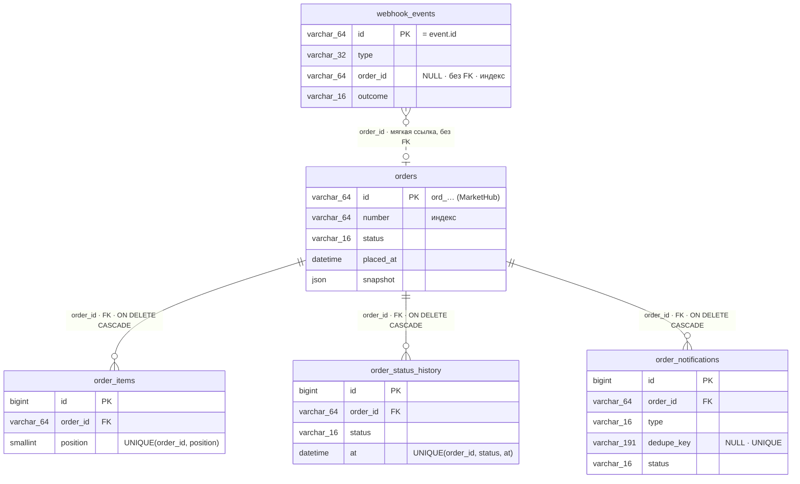

# Архитектура: модель данных и доменный слой

> Дата актуализации: 2026-10-27. Этап 1 — ERD и справочник доменных таблиц
> по §6.3 ТЗ; этап 2 (T-009) — скелет доменного слоя: конфигурация
> маркетплейса, DTO, классы доменных правил и исключения вебхука;
> этап 2 (T-010) — скелет обработки вебхука: маршрут, middleware
> подписи, Action и HTTP-маппинг результатов; этап 2 (T-011) — скелет
> API заказов: маршруты, FormRequest, query-класс и Resources.
> Таблица допустимости писем и детали outbox добавляются задачами T-012+.

## Содержание

- [Общие правила схемы](#общие-правила-схемы)
- [ERD доменных таблиц](#erd-доменных-таблиц)
- [Справочник таблиц](#справочник-таблиц)
- [Связи и правила удаления](#связи-и-правила-удаления)
- [Инфраструктурные таблицы](#инфраструктурные-таблицы)
- [Доменный слой: конфигурация, DTO, правила](#доменный-слой-конфигурация-dto-правила)
- [Скелет обработки вебхука (T-010)](#скелет-обработки-вебхука-t-010)
- [Скелет API заказов (T-011)](#скелет-api-заказов-t-011)
- [Воспроизводимость и проверки](#воспроизводимость-и-проверки)

## Общие правила схемы

- Кодировка `utf8mb4`; суммы — только `DECIMAL(12,2)`, плавающих типов в
  схеме нет (проверяется тестом `DomainSchemaTest`);
- Все доменные даты — `DATETIME` (точность 0), хранение в UTC; системные
  метки Eloquent (`created_at`/`updated_at`) — только там, где они указаны
  в §6.3: `orders`, `order_notifications`;
- Перечисления — PHP backed enums (`App\Enums\*`, задача T-004), в колонках
  `VARCHAR(16)`;
- `subtotal` не хранится: вычисляется при выводе как
  `price × quantity` через `Brick\Math\BigDecimal` (§6.3).

## ERD доменных таблиц

На диаграмме — только идентификаторы, ссылки и ключевые поля; полные
составы колонок — в [справочнике](#справочник-таблиц).



## Справочник таблиц

### `orders` — заказы MarketHub

Ключ — идентификатор заказа MarketHub (не автоинкремент:
`$incrementing = false`, `$keyType = 'string'`).

| Колонка | Тип | NULL | Ключи / индексы |
|---|---|---|---|
| `id` | `VARCHAR(64)` | нет | **PK** (`ord_…`) |
| `number` | `VARCHAR(64)` | нет | индекс |
| `status` | `VARCHAR(16)` | нет | индекс `(status, placed_at)` |
| `currency` | `CHAR(3)` | нет | |
| `customer_email` | `VARCHAR(255)` | нет | как пришло в снимке |
| `customer_email_normalized` | `VARCHAR(255)` | нет | индекс `(customer_email_normalized, placed_at)` |
| `customer_name` | `VARCHAR(255)` | нет | |
| `customer_phone` | `VARCHAR(64)` | да | |
| `delivery_price` | `DECIMAL(12,2)` | нет | |
| `discount` | `DECIMAL(12,2)` | нет | |
| `total` | `DECIMAL(12,2)` | нет | |
| `shipment_carrier` | `VARCHAR(64)` | да | все три `NULL` ⇔ `shipment = null` |
| `shipment_tracking_number` | `VARCHAR(64)` | да | |
| `shipment_tracking_url` | `VARCHAR(512)` | да | |
| `placed_at` | `DATETIME` | нет | индекс `(placed_at, id)` — сортировка списка |
| `source_updated_at` | `DATETIME` | нет | |
| `paid_at` | `DATETIME` | да | |
| `cancelled_at` | `DATETIME` | да | |
| `cancel_reason` | `TEXT` | да | |
| `version_event_created_at` | `DATETIME` | нет | компонент версии снимка (FR-ORD-02) |
| `version_event_id` | `VARCHAR(64)` | нет | компонент версии снимка |
| `snapshot` | `JSON` | нет | последний применённый снимок |
| `created_at`, `updated_at` | `TIMESTAMP` | да* | системные метки записи, в API не выходят |

\* В DDL nullable (`$table->timestamps()`); значения всегда заполняет
Eloquent, `NULL` в данных не возникает.

### `order_items` — позиции заказов

| Колонка | Тип | NULL | Ключи / индексы |
|---|---|---|---|
| `id` | `BIGINT UNSIGNED` | нет | **PK**, автоинкремент |
| `order_id` | `VARCHAR(64)` | нет | **FK → `orders.id`, CASCADE** |
| `position` | `SMALLINT` | нет | **UNIQUE `(order_id, position)`** |
| `sku` | `VARCHAR(64)` | нет | |
| `name` | `VARCHAR(255)` | нет | |
| `quantity` | `INT UNSIGNED` | нет | |
| `price` | `DECIMAL(12,2)` | нет | |

### `order_status_history` — история статусов

| Колонка | Тип | NULL | Ключи / индексы |
|---|---|---|---|
| `id` | `BIGINT UNSIGNED` | нет | **PK**, автоинкремент |
| `order_id` | `VARCHAR(64)` | нет | **FK → `orders.id`, CASCADE** |
| `status` | `VARCHAR(16)` | нет | **UNIQUE `(order_id, status, at)`** (идемпотентность FR-HIS-04) |
| `at` | `DATETIME` | нет | индекс `(order_id, at, id)` — хронология |
| `source_event_id` | `VARCHAR(64)` | да | событие, из которого следует факт |

### `webhook_events` — журнал обработки событий вебхуков

| Колонка | Тип | NULL | Ключи / индексы |
|---|---|---|---|
| `id` | `VARCHAR(64)` | нет | **PK** (= `event.id`) |
| `type` | `VARCHAR(32)` | нет | |
| `order_id` | `VARCHAR(64)` | да | **без FK**, индекс (см. ниже) |
| `signature_timestamp` | `INT` | нет | Unix-время из заголовка |
| `payload` | `MEDIUMTEXT` | нет | сырые байты тела, байт в байт |
| `payload_sha256` | `CHAR(64)` | нет | диагностика повторов с другим телом |
| `outcome` | `VARCHAR(16)` | нет | `applied\|stale\|ignored\|rejected` |
| `reject_reason` | `VARCHAR(32)` | да | |
| `deliveries` | `INT` | нет | `DEFAULT 1` |
| `received_at` | `DATETIME` | нет | |
| `last_received_at` | `DATETIME` | да | повторные доставки |
| `processed_at` | `DATETIME` | да | |

### `order_notifications` — transactional outbox писем

| Колонка | Тип | NULL | Ключи / индексы |
|---|---|---|---|
| `id` | `BIGINT UNSIGNED` | нет | **PK**, автоинкремент |
| `order_id` | `VARCHAR(64)` | нет | **FK → `orders.id`, CASCADE** |
| `type` | `VARCHAR(16)` | нет | `paid\|shipped\|cancelled` |
| `dedupe_key` | `VARCHAR(191)` | да | **UNIQUE** (NULL допустимы многократно) |
| `status` | `VARCHAR(16)` | нет | `pending\|sending\|sent\|skipped\|failed` |
| `skip_reason` | `VARCHAR(32)` | да | |
| `recipient` | `VARCHAR(255)` | да | заполняется при отправке |
| `subject` | `VARCHAR(255)` | да | заполняется при отправке |
| `attempts` | `INT UNSIGNED` | нет | `DEFAULT 0` |
| `source_event_id` | `VARCHAR(64)` | нет | событие-триггер |
| `last_error` | `TEXT` | да | |
| `sent_at` | `DATETIME` | да | |
| `created_at`, `updated_at` | `TIMESTAMP` | да* | системные метки |

\* В DDL nullable (`$table->timestamps()`); значения всегда заполняет
Eloquent, `NULL` в данных не возникает.

## Связи и правила удаления

Eloquent-связи (модель `Order`): `items()`, `history()`, `notifications()` —
`hasMany`; обратные — `order(): BelongsTo`. `WebhookEvent::order()` —
`belongsTo` по мягкой ссылке, может быть `null`.

| Связь | Правило на уровне БД | Обоснование |
|---|---|---|
| `order_items.order_id` → `orders.id` | FK, `ON DELETE CASCADE` | задано §6.3 |
| `order_status_history.order_id` → `orders.id` | FK, `ON DELETE CASCADE` | история — производные данные заказа |
| `order_notifications.order_id` → `orders.id` | FK, `ON DELETE CASCADE` | outbox-запись создаётся в одной транзакции с заказом (FR-MAIL-01); приложение заказы не удаляет |
| `webhook_events.order_id` → `orders.id` | **без FK** (индекс) | событие вставляется в журнал **до** создания заказа (§7, шаг 13a); для событий неизвестных типов `order_id = NULL`; журнал — независимый аудит, при удалении заказа строки сохраняются с исходной ссылкой |

Полная таблица решений по FK и типам — [`DECISIONS.md`](../DECISIONS.md),
разделы «Задача 003» и «Задача 008».

## Инфраструктурные таблицы

Стандартные миграции Laravel, доменными не являются: `users`,
`cache`/`cache_locks`, `jobs`/`job_batches`/`failed_jobs` (последние —
очередь Redis/Horizon). Очередные таблицы не дублируются собственными
миграциями (проверяется тестом `DomainSchemaTest`).

## Доменный слой: конфигурация, DTO, правила

Структура — по §10 ТЗ (T-009): DTO в `app/Data/`, доменные правила —
`app/Support/`, исключения вебхука — `app/Exceptions/Webhook/`. Парсинг
сырого JSON в DTO (валидация конверта и снимка) — задача T-021; классов
парсера в T-009 сознательно нет.

### Конфигурация `config/marketplace.php`

| Ключ | Env | Умолчание | Назначение (ТЗ) |
|---|---|---|---|
| `webhook_secret` | `MARKETPLACE_WEBHOOK_SECRET` | `''` | секрет подписи; пустое значение — fail closed (Q11) |
| `webhook_tolerance` | `MARKETPLACE_WEBHOOK_TOLERANCE` | `300` | окно timestamp, с (FR-WH-03) |
| `order_lock_timeout` | `MARKETPLACE_ORDER_LOCK_TIMEOUT` | `3` | ожидание блокировки заказа, с (FR-ORD-07) |
| `order_lock_lease` | `MARKETPLACE_ORDER_LOCK_LEASE` | `15` | срок владения блокировкой, с (> `MAIL_TIMEOUT`) |
| `terminal_statuses` | — | `['delivered','cancelled']` | терминальные статусы Q35/FR-ORD-09; единственное место истины для `OrderStatus::isTerminal()` |
| `events_retention_days` | `MARKETPLACE_EVENTS_RETENTION_DAYS` | `90` | хранение сырых событий, дней (Q20) |
| `notifications.max_attempts` | `NOTIFICATIONS_TRIES` | `5` | попыток отправки письма (FR-MAIL-05) |
| `notifications.backoff` | — | `[10, 60, 300, 900]` | паузы повторов: 10 с / 1 м / 5 м / 15 м |
| `notifications.sweep_after_seconds` | `NOTIFICATIONS_SWEEP_AFTER_SECONDS` | `120` | порог sweeper'а pending-уведомлений (FR-MAIL-06) |
| `notifications.refund_days` | `NOTIFICATIONS_REFUND_DAYS` | `10` | срок возврата в письме об отмене (§6.5) |

SMTP timeout читается отдельно: `config/mail.php` → `MAIL_TIMEOUT`
(5 с, §5.3). Лимит тела 1 MiB (FR-WH-12) конфигом §5.3 не задаётся —
его место (конфиг или константа middleware) определит T-025.

### DTO (`app/Data/`, readonly, без Eloquent)

| Класс | Что представляет |
|---|---|
| `MarketplaceEvent` | конверт события: `id`, `type`, `createdAt` (момент с исходным смещением), `?order` — null для событий без валидного снимка (неизвестный тип/статус) |
| `OrderSnapshot` | полный снимок `data.order` после валидации известного статуса; `status` — enum; суммы — строки с двумя знаками; nullable-поля — explicit null |
| `OrderCustomer` / `OrderItemSnapshot` / `OrderShipment` | вложенные значения снимка (`phone` nullable; `shipment` — объект или null) |
| `Version` | кортеж сравнимости `(order.updated_at, event.created_at, event.id)` (FR-ORD-02) |
| `HistoryFact` | «статус @ момент» из снимка (FR-HIS-02); `source_event_id` проставляет запись в БД |

### Доменные правила (`app/Support/`) и статус реализации

| Класс | Сигнатура | Реализация |
|---|---|---|
| `SnapshotVersionComparator` | `isNewer(Version $incoming, Version $stored): bool` | T-023 |
| `Money` | `subtotal(string $price, int $quantity): string` | T-022 |
| `HistoryBuilder` | `factsFromSnapshot(OrderSnapshot): list<HistoryFact>`; `rollbackFact(OrderStatus, OrderSnapshot): ?HistoryFact` | T-030 |
| `NotificationPolicy` | `allows(NotificationType $type, OrderStatus $currentStatus): bool` | T-031 |

До реализации методы бросают `LogicException` с номером задачи-владельца
(заглушка не изображает успешный результат — правило этапа 2).

### Исключения вебхука (`app/Exceptions/Webhook/`)

| Исключение | HTTP | Когда |
|---|---|---|
| `InvalidSignature` | 401 | формат/наличие заголовков, HMAC не совпал (FR-WH-02/04) |
| `StaleTimestamp` | 401 | timestamp вне окна (FR-WH-03) |
| `MalformedPayload` | 400 / 422 | тело не по протоколу; причина — enum `App\Enums\PayloadIssue`: `invalid_json`/`event_id_mismatch` → 400 (FR-WH-05), `invalid_envelope`/`invalid_snapshot` → 422 (FR-WH-06/08) |

HTTP-маппинг реализуют T-010/T-025. NFR-04: сообщения не содержат
секрет, подпись и тело запроса; 401 одинаков для всех причин отказа
аутентификации.

## Скелет обработки вебхука (T-010)

Поток входящего вебхука по §7/§10 ТЗ — HTTP-слой отделён от
транзакционной логики:

```text
POST /api/webhooks/marketplace                    routes/api.php (api-группа: без CSRF/throttle, FR-WH-11)
  → VerifyMarketplaceSignature                    §7 шаги 2–4: заголовки, окно, HMAC
  → MarketplaceWebhookController                  тонкий HTTP-слой: Request → IncomingWebhook
  → ProcessMarketplaceEvent::handle()             §7 шаги 5–14, один Action (заглушки T-021…T-032)
      → WebhookProcessingResult                   processed|duplicate|stale|ignored|rejected
  → WebhookResponseMapper::fromResult()           200 {"status": …}

WebhookException (middleware или Action) → $exceptions->render() в bootstrap/app.php
  → WebhookResponseMapper::fromException()        401 едино / 400/422 по PayloadIssue
```

| Компонент | Файл | Статус |
|---|---|---|
| Маршрут | `routes/api.php` | готов (api-маршрутизация включена в `bootstrap/app.php` вручную, FR-WH-01) |
| Проверка подписи | `app/Http/Middleware/VerifyMarketplaceSignature.php` | заголовки+окно готовы; сверка HMAC — заглушка `LogicException` (T-024), fail closed |
| Контроллер | `app/Http/Controllers/Api/MarketplaceWebhookController.php` | готов (без бизнес-логики) |
| Контекст доставки | `app/Data/IncomingWebhook.php` | готов (DTO: X-Webhook-Id, timestamp, сырое тело) |
| Оркестрация | `app/Actions/Webhooks/ProcessMarketplaceEvent.php` | скелет порядка §7; шаги — заглушки задач T-021…T-032 |
| Результаты | `app/Enums/WebhookProcessingResult.php` | готов; `fromOutcome(EventOutcome)`: `applied` → `processed`, `duplicate` только в HTTP |
| Ответы | `app/Http/Responses/WebhookResponseMapper.php` | 200/401/400/422 готовы; 413/503 добавят T-025/T-027 |

Тела ошибок — `{"error":{"code": …, "message": …}}` со статичными
текстами; 401 един для InvalidSignature и StaleTimestamp (`unauthorized`,
NFR-04), коды 400/422 — по `PayloadIssue`. До T-024 формально корректные
запросы упираются в заглушку HMAC (500, никакой `200 processed`) —
подробности в `DECISIONS.md`, раздел «Задача 010».

## Скелет API заказов (T-011)

Чтение заказов для админки по контракту `task/openapi.yaml` (§6.6 ТЗ) —
слои как у вебхука: HTTP → выборка → сериализация:

```text
GET /api/orders                                    routes/api.php (orders.index)
  → ListOrdersRequest                              FR-API-02/03/08: фильтры+пагинация → 422 стандартного формата
  → OrderListParameters (DTO)                      валидированные параметры, дефолты page=1/per_page=20
  → OrderListQuery::paginate()                     FR-API-01..03: сортировка, status-фильтр, пагинация + withQueryString
  → OrderListItemResource::collection()            FR-API-04: стандартная обёртка data/links/meta

GET /api/orders/{id}                               routes/api.php (orders.show)
  → OrdersController::show()                       eager loading items(position)/history, 404 → JSON
  → OrderResource                                  FR-API-05/06/07: все поля контракта, subtotal, даты UTC +00:00;
                                                  история по FR-HIS-04: at, ранг статуса, id
```

| Компонент | Файл | Статус |
|---|---|---|
| Маршруты | `routes/api.php` | готовы; состав api-маршрутов = контракт + вебхук, зафиксирован тестом (FR-API-11); `GET /up` — опция `health` в `bootstrap/app.php` |
| Валидация | `app/Http/Requests/Api/ListOrdersRequest.php` | готова (422 стандартного Laravel, пустые фильтры игнорируются) |
| Параметры | `app/Data/OrderListParameters.php` | готов (readonly DTO) |
| Выборка | `app/Http/Queries/OrderListQuery.php` | сортировка/status/пагинация честные; фильтр email — заглушка `LogicException` (T-036), fail closed |
| Контроллер | `app/Http/Controllers/Api/OrdersController.php` | готов (тонкий, eager loading карточки: items по position, history — порядок задаёт Resource) |
| Список | `app/Http/Resources/OrderListItemResource.php` | поля контракта, даты MarketHub (FR-API-07) |
| Карточка | `app/Http/Resources/OrderResource.php` | поля контракта + subtotal (BigDecimal) + история по FR-HIS-04 (at, ранг, id — сортировка коллекцией); контрактная проверка — T-037/T-038 |

Ответы api/* — всегда JSON независимо от Accept (`shouldRenderJsonWhen`
из T-010, FR-API-09). До T-036 запрос с непустым `email` получает 500 —
заглушка не изображает фильтрацию; подробности и решения — в
`DECISIONS.md`, раздел «Задача 011».

## Воспроизводимость и проверки

Схема воспроизводима на чистой MySQL 8.4: `migrate:fresh` → фабричная
генерация (`database/factories/*`) → `db:seed` (`DemoOrdersSeeder`) →
`migrate:rollback` → повторный `migrate` с сидером. Полный цикл зафиксирован
тестом `DatabaseReproducibilityTest` (поглотил rollback-сценарий T-003);
составные части — `DomainSchemaTest` (схема/ограничения/FK),
`DomainModelsTest` (модели/связи/касты, включая висячую мягкую ссылку),
`DomainFactoriesTest` (фабрики), `DemoOrdersSeederTest` (демо-набор).
Источник требований к схеме — §6.3 ТЗ (`plan/TZ-markethub-orders-service-v1.5.md`).
